# FINN — Financial Investment Agent

FINN is a mobile-first investing assistant for Indian equities. It does two jobs:

- **Push — the Brief.** Every NSE filing across a 19-stock portfolio is classified, scored for materiality and grouped into stories. You see the few that matter, with the numbers already pulled out, and routine paperwork is folded away.
- **Pull — the Research memo.** For any NSE-listed company, FINN builds a research memo from primary sources only. It leads with the **Promise Ledger**: what management guided on its last five earnings calls, set against what the company actually reported.

| | |
|---|---|
| **Live app** | https://finn-financial-investment-agent-eosin.vercel.app — open it on a phone and use *Add to Home Screen* to install it as a PWA |
| **API** | https://finn-api-bbyo.onrender.com — health check at [`/api/health`](https://finn-api-bbyo.onrender.com/api/health) |

> The API runs on Render's free plan, so the first request after a period of inactivity can be slow while the instance wakes up.

<p>
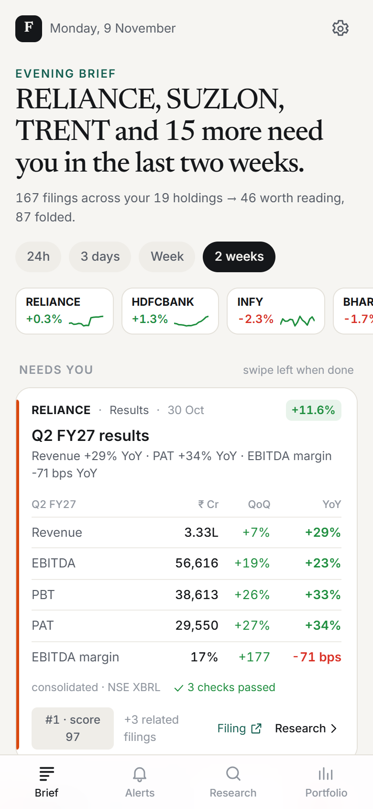
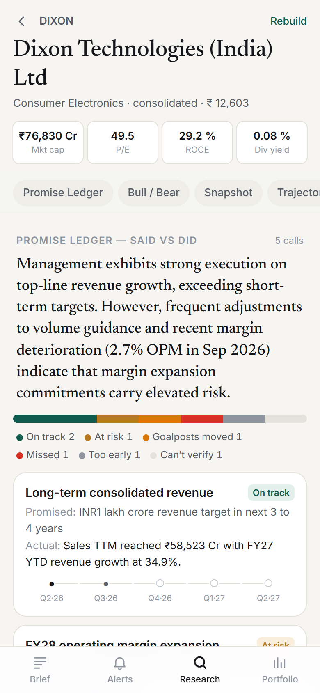
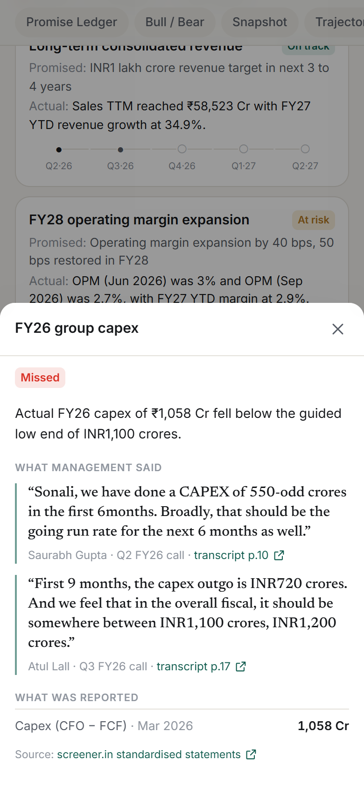
</p>

## Contents

- [Problem statement](#problem-statement)
- [Key capabilities](#key-capabilities)
- [Architecture](#architecture)
- [Technology stack](#technology-stack)
- [Application workflow](#application-workflow)
- [Repository layout](#repository-layout)
- [Getting started](#getting-started)
- [Deployment](#deployment)
- [API reference](#api-reference)
- [Testing and quality tooling](#testing-and-quality-tooling)
- [Screenshots](#screenshots)
- [Limitations](#limitations)
- [Future improvements](#future-improvements)
- [Deliberately left out](#deliberately-left-out)
- [How this was built](#how-this-was-built)

## Problem statement

An investor holding a portfolio of Indian stocks faces two problems:

1. **Too much noise.** Listed companies file a steady stream of exchange announcements — most of it routine (trading-window closures, newspaper adverts, compliance certificates). The few filings that matter are buried among them.
2. **Research that can't be trusted.** LLM-generated research reads well, but it can invent figures, paraphrase management loosely, attribute an analyst's question to the CEO, or compare numbers from the wrong periods.

FINN treats the day as **triage** — an inbox you can clear, not a dashboard — and treats research as an **evidence problem**: the model may judge and write, but every figure, quote and period it uses must be traceable to a primary source and is checked in code.

## Key capabilities

### Push mode — the Brief and alerts

| Capability | How it works |
|---|---|
| **Filing ingestion** | Announcements are fetched from NSE, with filing PDFs read page by page (`sources/nse.py`, `sources/docs.py`). EOD prices come from yfinance, with the NSE bhavcopy as a fallback for the latest session (`sources/prices.py`). |
| **Rules-first classification** | The exchange category is mapped to a reference category and refined with keyword rules over the filing's subject line and opening paragraph. The LLM is consulted only for catch-all buckets that no rule matches (`push/classify.py`). On two weeks of market-wide filings (11,450 announcements), rules alone classified **90.7%** — see [`docs/DECISIONS.md`](docs/DECISIONS.md). |
| **Explainable materiality** | A deterministic 0–100 score with human-readable reasons (`push/score.py`); tapping a story's score shows why it ranked. Stated penalties are sized against annual revenue, so small notices fold automatically (e.g. Bharti Airtel's four DoT notices of ₹1–54 lakh). |
| **Stories, not rows** | Filings from the same company and category within 36 hours are grouped into one story (results outcome + press release + investor deck). |
| **Results cards** | Quarterly results are parsed from NSE XBRL (exact rupee values), with screener.in as a fallback, and shown as this quarter vs last quarter vs the same quarter last year — no LLM involved (`push/results.py`). Results are cross-checked (PBT − tax ≈ PAT, and XBRL vs screener); on build day 19/19 holdings passed the arithmetic check and 18/19 agreed across sources. Disagreements are flagged, not hidden. |
| **Management changes** | For appointments and resignations, FINN extracts who, role and change, and the profile that SEBI requires inside the filing itself, linking the page (`push/enrich.py`). |
| **Alerts** | Evaluated on read against your thresholds: daily price move in % and in σ (the stock's own recent volatility), volume vs its trailing average, and filing categories above a materiality threshold. Price and volume alerts are linked to a same-session filing when one exists (`push/alerts.py`). |
| **The Brief** | One sentence on what needs you, ranked material stories ("Needs you", "Worth a look"), routine filings folded, time windows of 24h / 3 days / week / 2 weeks, and *swipe left when done* to clear a story (cleared state is stored on the device). |

### Pull mode — the Research memo

| Capability | How it works |
|---|---|
| **Any NSE company** | Search by company name or ticker; names are resolved against the NSE equity list before any research starts, and unmatched names never create a memo (`sources/symbols.py`). |
| **Deterministic sections** | Business snapshot, multi-year trajectory, balance sheet, cash quality and computed signals come from standardised statements with no LLM. Every number is registered in a **fact table** with a stable id (e.g. `calc.Q.ebitda_margin.Mar 2026`) that later stages cite (`pull/financials.py`). |
| **Quote-verified guidance** | The last five earnings-call transcripts are read in one long-context pass each. Every guidance quote is matched **verbatim** against the transcript, with its page recorded, and the speaker turn is located so moderator and analyst speech is not treated as management guidance (`pull/transcripts.py`). |
| **Promise Ledger** | Guidance across calls is grouped into promises and judged against the fact table: *delivered, missed, on track, at risk, goalposts moved, quietly dropped, too early,* or *can't verify* (`pull/ledger.py`). Each row shows the quotes (speaker, call, transcript page link) and the reported figures it rests on. |
| **Bull vs bear** | Three bull points, three bear points and one "watch" item, written only from computed signals, ledger rows, verified guidance and analyst questions — each point lists its sources (`pull/thesis.py`). |
| **Progressive build** | State is persisted after each stage, so the memo renders while it builds. Usage (model calls, tokens, cache hits) is recorded per memo. |
| **Freshness** | Opening a memo refreshes it only if it is older than 24 hours; at most one build per company runs at a time, a failed rebuild keeps the previous complete memo, and automatic retries wait 30 minutes. A **Rebuild** button forces a refresh (`pull/research.py`). |

### Evidence and verification layers

Every model-written section passes through checks in code. None of these trust the model's own judgement:

| Risk | What FINN does |
|---|---|
| Invented numbers | Any number in model-written prose must exist in the evidence the model was given (`grounding.py`). |
| Paraphrased or misattributed quotes | Verbatim matching against transcript text, page numbers recorded, analyst/moderator turns excluded. On build day this removed 10 of 38 HDFC Bank "guidance" quotes that were analysts' words. |
| Wrong fiscal period | One module owns the Indian fiscal calendar (`pull/periods.py`): FY26 = Apr 2025 – Mar 2026, a bare "Q4" on a call resolves from the call's own quarter. A promise is judged only on figures from its own period; a quarter or half-year that hasn't started is *too early*. |
| Rounded comparisons | Quarterly margin comparisons use exact margins (operating profit ÷ sales), never rounded OPM %. When a promise names its base quarter ("exceed our Q2 run-rate"), that quarter's exact figure is attached; if it is unavailable, the row is *can't verify*. |
| Over-confident verdicts | A verdict needs a reported figure or a later management statement; "missed" needs the deadline to have passed; numeric targets are range-checked in code; a row's title must name the promise's own period. Overridden verdicts are shown ("model said …; corrected by FINN's evidence check"). |
| Inconsistent prose | Deterministic narrative checks (`pull/narrative.py`): sequential vs year-on-year wording must match the cited figures; a trend must use one data series (exchange filing vs standardised statements); a figure must carry its own period label; a promise can be called met only if *delivered*, or failed only if *missed*; the credibility summary must agree with the final verdicts. |
| Claims the evidence doesn't support | A second model checks every bull/bear point and ledger verdict against **only its cited evidence** (`pull/verify.py`). Unsupported points get one rewrite; a point still flagged then gets a deterministic repair (wrong period label, mixed series, unsupported promise clause) and is re-verified. Anything still unsupported stays in the memo marked **"⚠ disputed by FINN's check"** — never silently marked verified. |

## Architecture

```
                        ┌──────────────── Push (scheduled) ─────────────────┐
NSE announcements, XBRL ┤                                                   │
NSE bhavcopy / yfinance ┼─► python -m finn.cli all  (GitHub Actions cron)   │
filing / transcript PDFs┘     fetch → classify → score → enrich             │
                                         │                                  │
                                         ▼                                  │
                              PostgreSQL (Neon in production;               │
                              SQLite locally)  ◄────────────────────────────┘
                                         ▲
screener.in statements ─┐                │
earnings-call PDFs ─────┼─► FastAPI on Render ──► /api/*  ◄── React PWA on Vercel
LLM providers (router) ─┘    research memos built on demand (Pull)
```

- **Frontend** — a React + TypeScript PWA (Vite, Tailwind CSS) with five screens: Brief, Alerts, Research, Memo and Portfolio (with a per-company page), plus a settings sheet for alert thresholds. A service worker caches the app shell and keeps the last API responses as an offline fallback.
- **Backend** — a FastAPI application (`finn/api.py`) over SQLAlchemy. The push pipeline is idempotent and safe to run on a schedule; research memos run in a background thread and persist after each stage.
- **Database** — PostgreSQL in production (Neon), SQLite (`backend/finn.db`) when `DATABASE_URL` is unset. Tables: `companies`, `prices_eod`, `announcements`, `alerts`, `kv` (memos, caches, settings) and `llm_calls` (every model call, for cost and cache visibility).
- **Data sources** — NSE, the National Stock Exchange of India (announcements, integrated-filing results in XBRL — the exchange's machine-readable financial format — and the daily bhavcopy price file); yfinance (EOD prices); screener.in, a public site of standardised Indian company financials (multi-year statements and links to earnings-call transcripts and annual reports); and the filing and transcript PDFs themselves.

### Research memo pipeline

```
symbol ─► financials.build()            fact table + deterministic sections        (no LLM)
       ─► transcripts.extract_all()     last 5 calls → verbatim, speaker-checked guidance   [long tier, cached]
       ─► ledger.build()                Promise Ledger verdicts                     [reason tier]
            └─ code guards: metric · fiscal period · exact margin · range · deadline · title · credibility
       ─► thesis.build()                bull / bear / watch                         [reason tier]
       ─► verification                  second model + narrative checks             [verify tier]
            └─ one rewrite ─► deterministic repair ─► re-verify ─► still unsupported = "disputed"
```

### Model routing

Tasks ask for a **tier**, never a specific model (`finn/llm.py`). The router walks the tier's candidates in quality order and skips providers without a key, benched models (until the provider's own `retryDelay`) and prompts that don't fit a model's token window. Any model can be overridden with `FINN_MODEL_<PROVIDER>_<TIER>`.

| Tier | Used for | Candidates (first available wins) |
|---|---|---|
| — (rules) | most classification and scoring | none — free |
| `fast` | ambiguous classification, one-liners, management-profile extraction | Groq gpt-oss-20b → Gemini 3.5 / 3.1 Flash-Lite → … |
| `long` | one pass per transcript → quote-verified guidance JSON | Gemini 3.5 Flash → Gemini 3 Flash (preview) → Gemini 3.5 Flash-Lite |
| `reason` | Promise Ledger verdicts and bull/bear, over extracted JSON — never raw documents | Gemini 3.5 Flash → Groq gpt-oss-120b → Gemini 3 Flash → Groq Qwen3.8-27B → Flash-Lite |
| `verify` | second-model claim check against cited evidence only | Groq gpt-oss-120b → Gemini 3 Flash → Groq Qwen / gpt-oss-20b → Flash-Lite |

OpenRouter, OpenAI and a local Ollama model are supported as optional further fallbacks. Responses are cached by a hash of model and messages (empty answers are never cached), as are PDFs, page text and XBRL facts.

## Technology stack

| Layer | Technology |
|---|---|
| Frontend | React 19, TypeScript, Vite, Tailwind CSS 4, PWA (web manifest + service worker), oxlint |
| Backend | Python 3.12, FastAPI, Uvicorn, SQLAlchemy 2, Pydantic |
| Data / parsing | requests, httpx, BeautifulSoup + lxml, PyMuPDF, pandas, yfinance |
| Database | PostgreSQL (Neon) via psycopg 3 in production; SQLite locally |
| LLMs | Google Gemini and Groq (free tiers) via an OpenAI-compatible router; OpenRouter / OpenAI / Ollama optional |
| Hosting | Vercel (frontend), Render (API), Neon (database), GitHub Actions (scheduled ingest) |
| Testing | pytest (backend), an httpx API smoke test, a Playwright screenshot script |

## Application workflow

1. **Open the Brief.** It opens with one sentence on what needs attention, the portfolio's price strip, and ranked material stories. Choose a window (24h → 2 weeks); tap a score to see its reasons; expand **Show the numbers** on a results story; swipe a story left once it's dealt with.
2. **Check Alerts.** Price, volume and filing alerts against your thresholds, each linked to what was filed that session. The settings sheet (the gear on the Brief, or **Edit** on the Alerts thresholds card) changes thresholds and watched filing categories.
3. **Browse the Portfolio.** Holdings by weight with daily moves; each company page shows price and filings and its latest results card.
4. **Research a company.** From a story's **Research** link or the Research tab, search by name or ticker and press Enter. The memo builds progressively (statements → transcripts → ledger → bull/bear → cross-check).
5. **Read the evidence.** Tap a Promise Ledger row to see what management said (verbatim, with speaker, call and transcript page) and what was reported (figure, period, source). Tap a bull/bear point's sources to see its evidence.

## Repository layout

```
backend/
  finn/
    api.py            FastAPI routes          cli.py   init / prices / ingest / enrich / reprocess / research / all
    llm.py            tier-based model router grounding.py  number checks   db.py  models + KV store
    sources/          nse.py · screener.py · prices.py · docs.py (PDF text, verbatim quotes) · symbols.py
    push/             classify.py · score.py · results.py · enrich.py · alerts.py · ingest.py · present.py
    pull/             financials.py · transcripts.py · ledger.py · periods.py · thesis.py · narrative.py
                      verify.py · research.py
  tests/              pytest suites + fixtures from real filings and memos
  portfolio.json      the 19-stock mock portfolio
frontend/src/
  screens/            Brief · Alerts · Research · Memo · Portfolio · SettingsSheet
  components/         Story · Charts · ui          lib/  api · hooks · format
scripts/              audit_periods · validate_memo · smoke_test · eval_results · screens · migrate_sqlite_to_neon
spikes/               day-1 data-availability checks, kept as evidence
docs/                 DECISIONS.md (data findings and decision log) · screens/ · ai-history/ (build transcript)
render.yaml           Render service definition      .github/workflows/ingest.yml  scheduled push pipeline
```

## Getting started

### Prerequisites

- **Python 3.12** (production uses 3.12.10)
- **Node.js 22 LTS** and npm
- At least one free LLM key: **Gemini** ([Google AI Studio](https://aistudio.google.com/)) or **Groq** ([console.groq.com](https://console.groq.com/)). Both give routing and fallback. Without a key, the deterministic sections still build and AI sections are skipped.

### 1. Backend

**Windows (PowerShell)**

```powershell
cd backend
py -3.12 -m venv .venv
.\.venv\Scripts\Activate.ps1          # if blocked: Set-ExecutionPolicy -Scope Process RemoteSigned
pip install -r requirements.txt
Copy-Item .env.example .env           # then edit .env and add GEMINI_API_KEY and/or GROQ_API_KEY
$env:PYTHONIOENCODING = "utf-8"       # lets console output print ₹ and other symbols
```

**macOS / Linux**

```bash
cd backend
python3.12 -m venv .venv
source .venv/bin/activate
pip install -r requirements.txt
cp .env.example .env                  # then add GEMINI_API_KEY and/or GROQ_API_KEY
```

### 2. Environment variables

Set these in `backend/.env` (never commit it; `.env` is git-ignored). Leave `DATABASE_URL` unset locally to use SQLite.

| Variable | Needed | Purpose |
|---|---|---|
| `GEMINI_API_KEY` / `GROQ_API_KEY` | at least one | LLM providers for the AI sections |
| `DATABASE_URL` | production | PostgreSQL connection string; unset → SQLite at `backend/finn.db` |
| `FINN_INGEST_TOKEN` | production | protects `POST /api/ingest` (sent as the `X-Finn-Token` header) |
| `FINN_CORS_ORIGINS` | production | comma-separated allowed origins (default `*`) |
| `FINN_CACHE_DIR` | optional | directory for cached PDF bytes |
| `OPENROUTER_API_KEY`, `OPENAI_API_KEY` | optional | additional fallback providers |
| `FINN_USE_OLLAMA=1`, `OLLAMA_URL` | optional | use a local Ollama model as a last resort |
| `FINN_MODEL_<PROVIDER>_<TIER>` | optional | override a tier's model, e.g. `FINN_MODEL_GEMINI_REASON` |

The frontend reads one build-time variable, **`VITE_API_URL`** — the API's base URL. Leave it unset for local development; the Vite dev server proxies `/api` to `http://127.0.0.1:8000`.

### 3. Load data and run

From `backend/` with the virtual environment active:

```bash
python -m finn.cli all 14              # load portfolio, fetch EOD prices, ingest 14 days of filings
python -m finn.cli research DIXON      # optional: build one memo from the command line
uvicorn finn.api:app --port 8000       # API at http://127.0.0.1:8000/api/health
```

Other CLI commands: `init`, `prices`, `ingest <days>`, `enrich [--retry]`, `reprocess [--no-llm]`, `research <SYMBOL> [--force]`.

In a second terminal:

```bash
cd frontend
npm install
npm run dev                            # http://localhost:5173
```

### 4. Run the tests

```bash
cd backend
pip install pytest                     # test dependency; not in requirements.txt
python -m pytest -q                    # 299 tests

cd ../frontend
npm run lint                           # oxlint
npm run build                          # TypeScript type-check + production build
```

## Deployment

| Component | Host | Configuration |
|---|---|---|
| Frontend | Vercel — https://finn-financial-investment-agent-eosin.vercel.app | `frontend/vercel.json` (Vite build, `dist/`, long-lived asset caching). `VITE_API_URL` is a Vercel project environment variable, baked into the bundle at build time. |
| API | Render (free plan, Singapore) — https://finn-api-bbyo.onrender.com | `render.yaml`: `pip install -r requirements.txt`, `uvicorn finn.api:app`, health check `/api/health`. It declares `DATABASE_URL`, `GEMINI_API_KEY` and `GROQ_API_KEY` as secrets entered in the Render dashboard, and asks Render to generate `FINN_INGEST_TOKEN`. |
| Database | Neon PostgreSQL | Connection string supplied as `DATABASE_URL`. `scripts/migrate_sqlite_to_neon.py` copies a local SQLite database into Postgres. |
| Scheduled ingest | GitHub Actions — `.github/workflows/ingest.yml` | Scheduled every 30 minutes from 08:30 to 21:00 IST on weekdays, plus 18:30 IST after the EOD price print; runs `python -m finn.cli all` and then calls `/api/health` to keep the API warm. It reads `DATABASE_URL`, `GEMINI_API_KEY`, `GROQ_API_KEY` and `API_URL` from repository secrets. See [Limitations](#limitations). |

Both services are deployed from the `main` branch.

## API reference

| Method | Route | Purpose |
|---|---|---|
| GET | `/api/health` | status, available model tiers, filing count, latest filing time |
| GET | `/api/digest?hours=` | the Brief: stories, counts and routine filings for a window |
| GET | `/api/alerts?days=` | triggered alerts plus the current thresholds |
| GET / PUT | `/api/settings` | alert thresholds and watched categories |
| GET | `/api/portfolio` | holdings with weights, prices and recent-material counts |
| GET | `/api/company/{symbol}` | company page: price history, filings, results card |
| GET | `/api/announcement/{id}` | one filing as a story |
| GET | `/api/search?q=` | resolve a company name or ticker against the NSE equity list |
| GET | `/api/research` | all memos with status, last update and verdict counts |
| POST | `/api/research/{symbol}?force=` | start a memo build if one is due (or forced); returns current state |
| GET | `/api/research/{symbol}` | read a memo (used for polling while it builds) |
| POST | `/api/ingest` | trigger the push pipeline (requires `X-Finn-Token`) |
| GET | `/api/usage` | model calls, tokens and cache hits by task |

## Testing and quality tooling

- **299 backend tests** (`backend/tests/`): the fiscal calendar and promise-period resolution, ledger guards, exact-margin comparisons, narrative checks and repairs, the verification pipeline (including the verifier being unavailable), stale-memo refresh safety (fresh, stale, repeated, concurrent, failed), and company-name resolution. Many cases replay real rows from production memos (`ledger_rows_fixture.json`, `narrative_fixture.json`) and real market-wide filings (`nse_2w.json`).
- **`scripts/audit_periods.py`** — read-only audit of memos through the API: flags ledger rows judged on figures from the wrong fiscal period, or margin comparisons decided on rounded OPM %.
- **`scripts/validate_memo.py`** — independently re-checks a stored memo: every quote verbatim on its cited page, ledger ids and numbers grounded in their own evidence, thesis structure and references.
- **`scripts/smoke_test.py`** — calls every API endpoint the frontend uses, through the Vite dev server's proxy, and exits non-zero on any failure.
- **`scripts/eval_results.py`** — results engine across the portfolio (arithmetic and cross-source checks).
- **`scripts/screens.py`** — phone-sized screenshots of the running app with Playwright.
- **`docs/DECISIONS.md`** — data findings and decisions, with the measurements quoted in this README.

## Screenshots

An evaluator's path through the app, from the daily Brief to the evidence behind a research claim. All images are in [`docs/screens/`](docs/screens/); the Tata Technologies (TATATECH) screens come from the production memo built on 10 November 2026.

### 1. Push — the Brief and its ranking

<table>
<tr>
<td width="42%" valign="top"></td>
<td valign="top">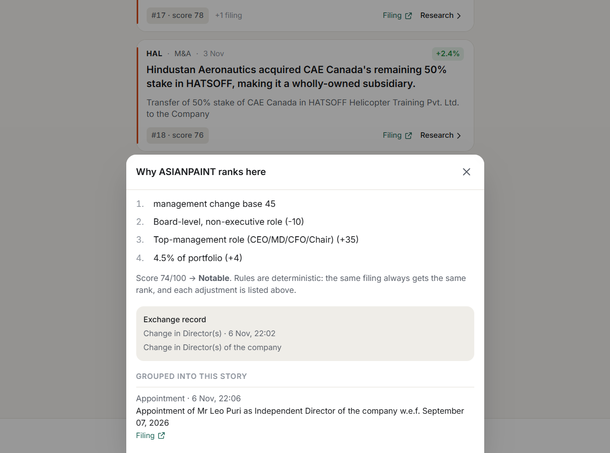</td>
</tr>
<tr>
<td valign="top"><sub><b>Brief.</b> One sentence on what needs you, then ranked material stories. Results arrive as a ready-made card — Q2 FY27 revenue, EBITDA, PBT and PAT vs last quarter and last year, from NSE XBRL, with “3 checks passed”.</sub></td>
<td valign="top"><sub><b>Materiality, explained.</b> Tapping a story's score lists every rule that produced it — here an Asian Paints management change: base 45, −10 for a non-executive board role, +35 for a top-management role, +4 for portfolio weight → 74, <i>Notable</i> — plus the exchange record and the filings grouped into the story.</sub></td>
</tr>
</table>

### 2. Alerts and company search

<table>
<tr>
<td width="50%" valign="top">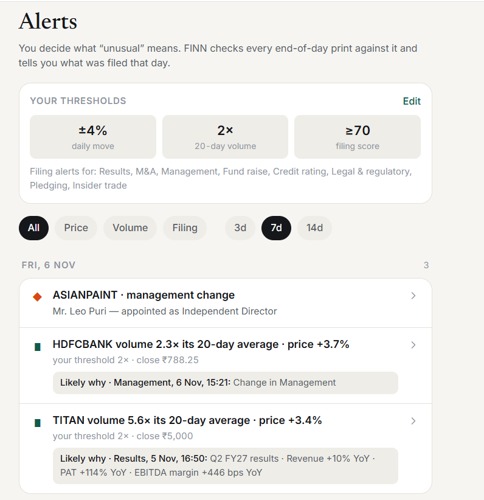</td>
<td valign="top">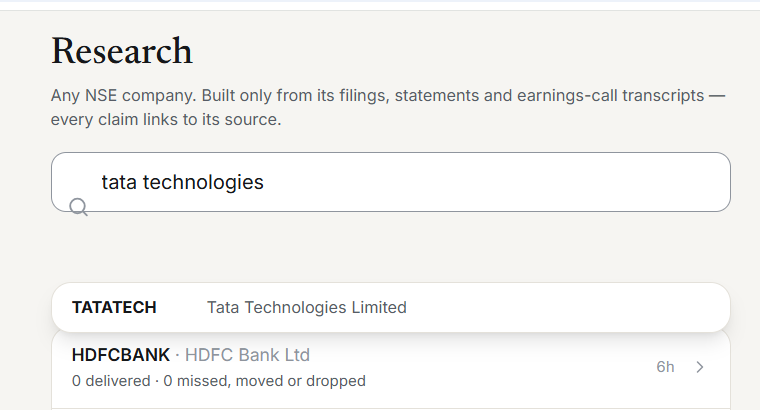</td>
</tr>
<tr>
<td valign="top"><sub><b>Alerts.</b> Your own thresholds (±4% daily move, 2× 20-day volume, filing score ≥ 70). Each price or volume alert names the filing that most likely explains it (“Likely why”).</sub></td>
<td valign="top"><sub><b>Research search.</b> Typing a company name — “tata technologies” — resolves it to its NSE ticker, TATATECH, before any research starts.</sub></td>
</tr>
</table>

### 3. Pull — the Promise Ledger and its evidence

<table>
<tr>
<td width="42%" valign="top"></td>
<td valign="top">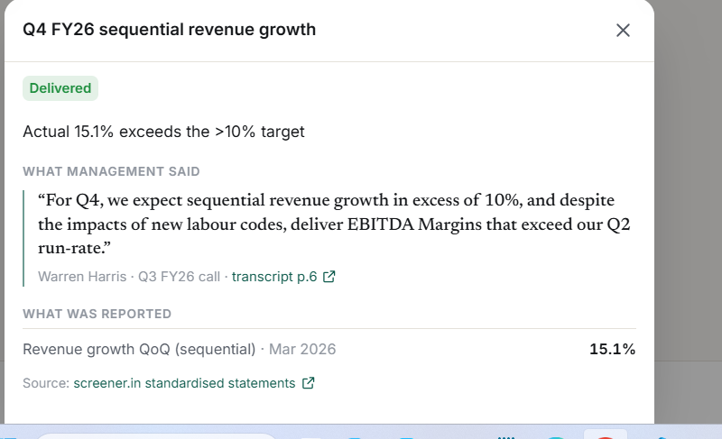</td>
</tr>
<tr>
<td valign="top"><sub><b>Promise Ledger (Dixon Technologies).</b> What management guided on five earnings calls vs what was reported, with a one-paragraph credibility read and the mix of verdicts.</sub></td>
<td valign="top"><sub><b>Delivered.</b> TATATECH guided sequential revenue growth above 10% for Q4 FY26 on its Q3 FY26 call; it reported 15.1% for the March 2026 quarter. The quote is verbatim, with the speaker and a link to the transcript page.</sub></td>
</tr>
</table>

<table>
<tr>
<td width="50%" valign="top">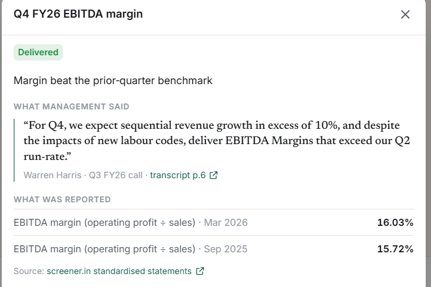</td>
<td valign="top">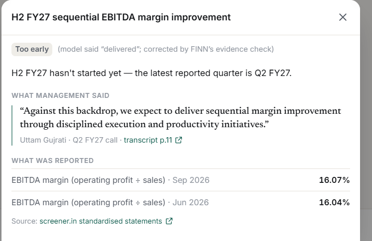</td>
</tr>
<tr>
<td valign="top"><sub><b>Exact figures, right periods.</b> “Exceed our Q2 run-rate” is judged on exact margins — 16.03% for Q4 FY26 vs 15.72% for Q2 FY26 (operating profit ÷ sales) — not on rounded OPM %, which shows 16% for both.</sub></td>
<td valign="top"><sub><b>Code overrides the model.</b> The model called the H2 FY27 margin promise “delivered”; FINN's fiscal-period check marks it <i>Too early</i> because H2 FY27 hasn't started, and says so on the verdict.</sub></td>
</tr>
</table>

### 4. Bull vs bear, with sources

<table>
<tr>
<td width="50%" valign="top">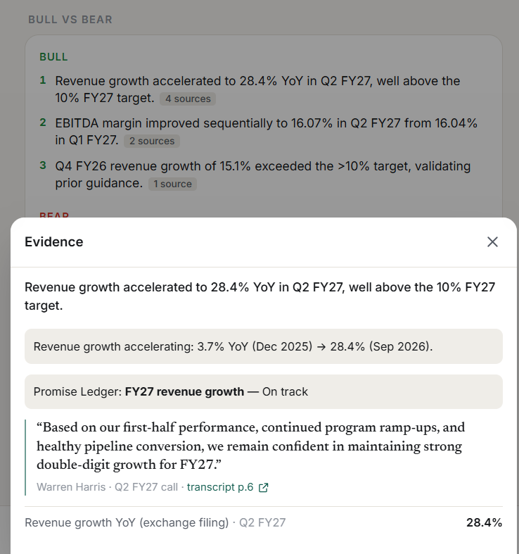</td>
<td valign="top"><sub><b>Every point shows its sources.</b> Tapping “4 sources” on a bull point opens the evidence it was written from: the computed revenue-growth signal, the Promise Ledger row it relies on (<i>On track</i>), management's verbatim guidance and the exchange-filing figure (28.4% YoY in Q2 FY27).</sub></td>
</tr>
</table>

### More screens

<table>
<tr>
<td width="50%" valign="top">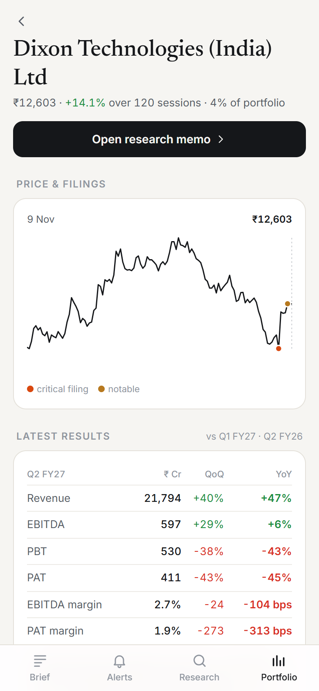</td>
<td valign="top">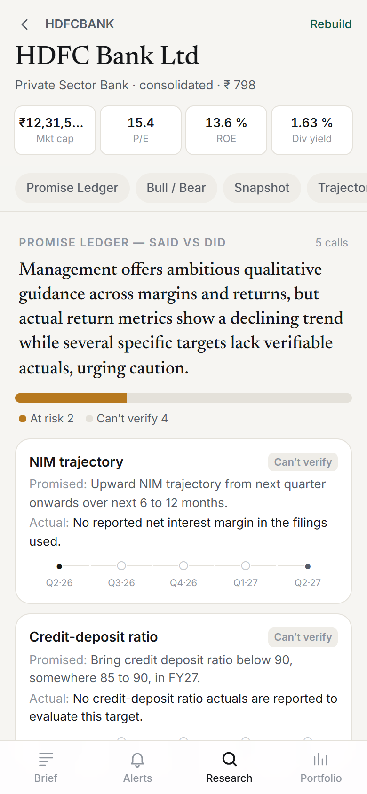</td>
</tr>
<tr>
<td valign="top"><sub><b>Company page.</b> Price history with critical and notable filings marked, and the latest results card.</sub></td>
<td valign="top"><sub><b>Refusing to use a proxy.</b> In a bank's memo, promises about metrics the sources don't report — such as net interest margin — are marked <i>Can't verify</i> rather than judged on a different figure.</sub></td>
</tr>
</table>

## Limitations

- **Unofficial data access.** NSE endpoints sit behind bot protection and screener.in is read from its public pages; either can change format or rate-limit without notice.
- **Free-tier models and hosting.** When FINN was built, Gemini's free tier allowed about 20 requests a day per model and Groq's about 8k tokens a minute (noted in `finn/llm.py`), so a memo build can fall back to weaker models. The free Render instance sleeps when idle.
- **Model output varies between builds.** The checks guarantee consistency, not wording. A point that cannot be repaired deterministically stays in the memo marked *disputed* rather than being removed, and the second-model verifier can occasionally reject a correct ledger verdict.
- **Pattern-based narrative checks.** Series and period-label checks cover percentage figures, and a period label is recognised when it follows the figure ("1.7% in FY26"), not when it precedes it.
- **Scheduled ingest is not confirmed to be running.** GitHub records a single run of the ingest workflow (9 November 2026, 23:50 UTC), and the latest filing reported by the production API is from 9 November, so the Brief may show stale filings. The cause has not yet been diagnosed.
- **One mock portfolio, no accounts.** Alert settings are shared server-side; per-viewer state (window, cleared stories) lives on the device.
- **Viewing can trigger a rebuild.** Opening a memo older than 24 hours refreshes it automatically (one build at a time, failures don't replace the existing memo), which consumes model quota.
- **Testing gaps.** There are no frontend unit or browser tests (the frontend is checked by type-checking and lint), and Vercel preview deployments are not wired to the API.

## Future improvements

- Diagnose why the scheduled ingest has not been running, add run monitoring, and show the last-ingest time in the app.
- Report the deployed commit in `/api/health`, and show `refresh_failed` / disputed counts in the memo header.
- Extend narrative checks beyond percentages (₹ amounts, ratios) and to labels that precede a figure.
- Stabilise the ledger-verdict prompt for the second-model verifier.
- Add frontend component tests and wire preview deployments to a staging API.
- Accounts and multiple portfolios, with per-user alert settings.

## Deliberately left out

- **Intraday prices, macro data and news.** The brief calls for EOD prices and, for research, primary sources only.
- **RAG over 300-page annual reports.** Transcripts fit in context whole; structured extraction once per document is cheaper and more complete than retrieval.
- **LinkedIn scraping.** It is against LinkedIn's terms, and the profile SEBI requires inside the filing is a better source.

## How this was built

FINN was built with an AI coding assistant. The decision log is in [`docs/DECISIONS.md`](docs/DECISIONS.md), and the build transcript is exported to [`docs/ai-history/`](docs/ai-history/) with environment values redacted by `scripts/export_history.py`.
