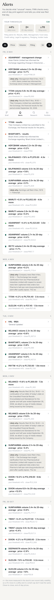

# FINN — Financial Investment Agent

A mobile-first investor tool with two jobs:

- **Push — the Brief.** Every filing across a 19-stock portfolio is classified, scored for materiality and clustered into stories. You see the few that matter, each with the numbers already pulled out. Everything routine is folded away.
- **Pull — the Research memo.** For any NSE company, FINN builds a memo from primary sources only. It leads with the **Promise Ledger**: what management guided on its last five earnings calls, set against what the company actually reported.

> **Live:** _link added after deploy_ · open it on a phone and *Add to Home Screen* to install it.

<p>



</p>

## The point of view

An investor's day is triage, so FINN behaves like **an inbox you can clear**, not a dashboard:

- The Brief opens with one sentence on what needs you.
- Material stories are ranked, and every rank can be explained (tap the score).
- You swipe a story away once you've dealt with it.
- Routine paperwork is folded but stays one tap away.
- Every story links straight into research.

You set the alert thresholds. Moves are reported in both % and σ (standard deviations of the stock's own recent volatility), and each move is linked to whatever was filed that session.

## What makes it trustworthy

| Problem | What FINN does |
|---|---|
| LLMs invent numbers | **The model never produces a figure.** Results come from NSE XBRL (exact rupee values), and multi-year data from standardised statements, computed in code. Any number in model-written prose must exist in the evidence the model was given, otherwise it is flagged. |
| Quotes get paraphrased | Every guidance quote is matched **verbatim** against the transcript text, and the page number is recorded. Unmatched or non-forward-looking statements are discarded, and the count is shown. |
| Confident verdicts with no evidence | A delivered / missed / on-track verdict needs a reported figure or a later management statement. Otherwise it is downgraded to "can't verify", and the downgrade is shown. |
| One data source can be wrong or late | Results are cross-checked: XBRL vs screener and PBT − tax ≈ PAT. **19/19 holdings pass the arithmetic check; 18/19 agree across two sources.** The exception (HDFC Bank: screener uses a different PAT aggregation) is shown as an amber flag, not hidden. |
| "CFO resigned" says nothing | SEBI requires a brief profile of any newly appointed director or key manager *inside the filing*. FINN extracts it and links the page, so the bio comes from a primary source, not scraped LinkedIn. |
| Most filings are noise | 11,450 market-wide filings over two weeks: **90.7% are classified by rules with no LLM call.** When a filing's summary is generic, FINN reads its "Sub:" line and opening paragraph instead. Penalties are sized against annual revenue (a ₹1.07 lakh DoT fine for Bharti Airtel is folded automatically). |

## Architecture

```
NSE (announcements, XBRL results, bhavcopy) ─┐
Yahoo Finance (EOD prices) ──────────────────┼─► ingest (GitHub Actions cron) ─► Postgres ◄─ FastAPI ◄─ React PWA (Vercel)
screener.in (statements, transcript links) ──┘        classify → score → enrich               │
BSE-hosted PDFs (filings, transcripts) ──────────────────────────────────────────────────────┘ research on demand
```

**Model routing.** Each task asks for a *tier*, never a specific model:

| Tier | Used for | Candidates (first available wins, fallback on error or rate limit) |
|---|---|---|
| rules | most classification and scoring | — (free) |
| `fast` | ambiguous classification, one-liners, management-profile extraction | Groq Llama 3.1 8B → Gemini Flash-Lite → … → local Ollama |
| `long` | one pass per transcript (~16k tokens) → quote-verified guidance JSON | Gemini 2.5 Flash → Flash-Lite → … |
| `reason` | Promise Ledger verdicts and bull/bear, over *extracted JSON*, not raw documents | Gemini 2.5 Flash → Groq gpt-oss-120b → … |

Everything is cached by content hash: PDFs, page text, XBRL facts and LLM responses (empty answers are never cached). Each memo shows its own model calls, tokens and cache hits.

## Repository

```
backend/finn/
  sources/   nse.py (announcements, XBRL) · screener.py · prices.py · docs.py (PDF text, verbatim-quote finder, Sub: line)
  push/      classify.py · score.py (explainable materiality) · results.py (3-quarter XBRL engine) · enrich.py · alerts.py · ingest.py
  pull/      financials.py (fact table + signals) · transcripts.py · ledger.py (Promise Ledger) · thesis.py · research.py
  llm.py     provider-agnostic router · grounding.py (number checks) · api.py
frontend/src/  screens/ (Brief, Alerts, Research, Memo, Portfolio) · components/ (Story, Charts, ui)
spikes/      day-1 data-availability checks, kept as evidence
docs/        DECISIONS.md (data findings and decision log) · screens/ · ai-history/ (build transcripts)
```

## Run locally

```bash
cd backend && uv venv && uv pip install -r requirements.txt
cp .env.example .env            # add GEMINI_API_KEY and/or GROQ_API_KEY
python -m finn.cli all 14       # portfolio + prices + 14 days of filings
python -m finn.cli research DIXON
uvicorn finn.api:app --port 8000

cd ../frontend && npm install && npm run dev   # http://localhost:5173 (proxies /api)
```

Evaluation scripts: `scripts/eval_results.py` (results engine across the portfolio) and `backend/tests/nse_2w.json` (two weeks of market-wide filings used to measure rule coverage).

## Deliberately left out

- Intraday prices, macro data and news. The brief asks for EOD prices and, on the pull side, primary sources only.
- User accounts. There is one mock portfolio; per-viewer state (window, cleared stories) is stored on the device.
- RAG over 300-page annual reports. Transcripts fit in context whole, and structured extraction once per document is cheaper and more complete than retrieval.
- LinkedIn scraping. It is against LinkedIn's terms, and the mandated profile in the filing is a better source.
